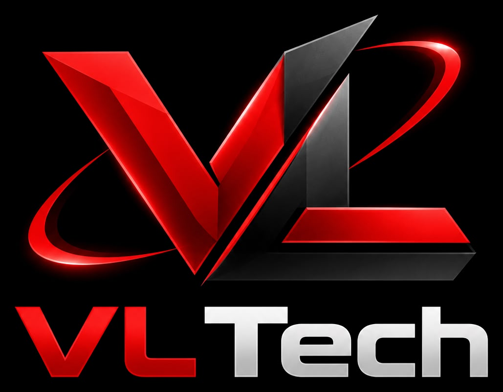

# ⚡ VL Tech — High Performance Software Engineering

<div align="center">



**Experiência Web Cinemática de Alta Performance**  
*Desenvolvida com foco obsessivo em precisão cirúrgica, animações fluidas em 60/120fps e design editorial moderno.*

[](https://vercel.com/new)
[](LICENSE)
[](https://greensock.com/)
[]()

[Demonstração](#-visão-geral) • [Recursos](#-recursos-principais) • [Scrollytelling Hero](#-sequência-cinemática-de-scrollytelling) • [Deploy na Vercel](#-deploy-na-vercel) • [Equipe](#-sócios--liderança-técnica)

</div>

---

## 📖 Visão Geral

A **VL Tech** é uma agência de engenharia de software de ponta, especializada na criação de ecossistemas digitais robustos, automações inteligentes e interfaces imersivas de alta fidelidade visual. 

Este projeto foi construído inspirado em padrões internacionais premiados (**Awwwards**, **FWA**), combinando uma estética minimalista flutuante no tema **Black & Crimson** (`#0A0A0C` e `#FF1E26`) com arquitetura modular em **JavaScript ES Modules**, animações matemáticas via **GSAP 3 + ScrollTrigger** e sintetização de áudio em tempo real via **Web Audio API**.

---

## ✨ Recursos Principais

### 1. 🎬 Sequência Cinemática de Scrollytelling (Hero Section)
Uma narrativa interativa guiada pela rolagem do usuário com pinning dinâmico (`pin: true`) através do GSAP ScrollTrigger:
1. **Estado Inicial (Luiz Gabriel):** O nome "LUIZ GABRIEL" ganha destaque imediato com a inicial 'L' estilizada em vermelho neon e seu retrato editorial com máscara radial orgânica.
2. **1ª Etapa de Rolagem:** Revelação suave e sincronizada dos textos de especialidade em Front-end, Arquitetura Web e do badge conceitual de conexão da marca.
3. **2ª Etapa de Rolagem:** Encerramento dos elementos do primeiro fundador em fade-out; a tela atinge o preto absoluto (`#0A0A0C`) e o logotipo oficial da VL surge centralizado em um raio de imersão expansivo.
4. **3ª Etapa de Rolagem:** O logotipo central foca exclusivamente na letra 'V', que se incendeia com um brilho intenso vermelho neon (`#FF1E26`), desliza suavemente até o canto superior da tela e fixa-se como âncora da marca.
5. **4ª Etapa de Rolagem:** Apresentação monumental do co-founder **Victor Whohlers**, revelando seu retrato limpo, especialidades em Back-end, Cloud & Lógica de Sistemas.
6. **Conclusão:** Liberação imperceptível do pin do ScrollTrigger para que o usuário prossiga suavemente para as próximas seções.

### 2. 🔊 Sistema de Efeitos Sonoros Nativos (Sound FX Engine)
- Sintetizador construído 100% sobre a **Web Audio API** do navegador (zero arquivos de áudio externos, sem risco de 404 ou latência).
- Micro-sons dinâmicos sintetizados com osciladores senoidais e triangulares:
  - **Hover suave** em botões, links e cards;
  - **Click tátil** com decaimento exponencial;
  - **Harmônicos de abertura e fechamento** do menu em tela cheia;
  - **Ignição sonora e swoosh** nas transições do scrollytelling.
- Botão interativo **FX ON / FX OFF** em formato de pílula integrado ao header, com persistência automática de preferência no `localStorage`.

### 3. 🌐 Cabeçalho Minimalista Flutuante
- Header 100% transparente integrado ao topo da página sem caixas pesadas.
- Logotipo oficial à extrema esquerda.
- Seletor de perfil interativo e botões de ação rápida no centro flutuante.
- Botão de áudio (Sound FX) e menu hambúrguer arredondado à extrema direita.
- Menu em tela cheia com overlay fluido e bloqueio inteligente de scroll.

### 4. 🚀 Seção de Serviços com Rolagem Horizontal (Pinned Track)
- Pinned viewport que converte o scroll vertical em deslocamento horizontal fluído dos cards de serviço da agência.

### 5. 🎴 Hall of Fame / Portfólio em Leque 3D
- Apresentação em perspectiva 3D dos projetos de clientes reais desenvolvidos pela agência (Maciel Fit, Zildo Oliveira, G4 Beneficiadora, Marinho Odonto, Ribeiro Team).
- Efeito de profundidade com cartões sobrepostos em arco e bordas com brilho vermelho.

### 6. ⏳ Preloader Editorial Imersivo
- Tela preta de alta prioridade (`z-index: 99999`) com contador numérico de progresso (0% a 100%) e barra de carregamento com brilho neon.
- Saída cinematográfica em cortina deslizante (`yPercent: -100`) com curva de aceleração `power4.inOut`.

---

## 🛠️ Tecnologias Utilizadas

- **HTML5 Semântico:** Marcação acessível (`aria-*`), metatags SEO completas e OpenGraph.
- **CSS3 Vanilla & Design System:** Tokens em `css/variables.css`, grid flexível, glassmorphism, tipografia display monument e animações aceleradas por GPU.
- **JavaScript Moderno (ES6+ Modules):** Arquitetura desacoplada em módulos (`js/hero.js`, `js/sound.js`, `js/scroll.js`, `js/navigation.js`, `js/loader.js`).
- **GSAP 3 & ScrollTrigger:** Motor de animações cinemáticas de alta precisão.
- **Web Audio API:** Geração procedural de som em tempo real.

---

## 🚀 Como Executar Localmente

1. Clone o repositório:
```bash
git clone https://github.com/Luiz-Gabriel-m/VL_Tech_Page.git
cd VL_Tech_Page
```

2. Sirva os arquivos estáticos com qualquer servidor web:
```bash
# Usando Python:
python -m http.server 5500

# Usando Node/npx:
npx serve .

# Ou no Windows PowerShell:
.\serve.ps1 -Port 5500
```

3. Acesse `http://localhost:5500` no seu navegador.

---

## ☁️ Deploy na Vercel

O projeto já está 100% preparado para deploy contínuo na Vercel:

1. Importe o repositório na dashboard da [Vercel](https://vercel.com/new).
2. Deixe as opções padrão de **Other / Static Site**.
3. O arquivo [`vercel.json`](vercel.json) já inclui cabeçalhos otimizados de cache para assets estáticos e suporte a URLs limpas.
4. Clique em **Deploy**.

---

## 👥 Sócios & Liderança Técnica

<div align="center">

| **Luiz Gabriel** | **Victor Whohlers** |
| :---: | :---: |
| *Co-founder & Tech Lead* | *Co-founder & Cloud Architect* |
| **Expertise:** Front-end, Arquitetura Web & Automações | **Expertise:** Back-end, Cloud & Lógica de Sistemas |
| **Conexão:** Front-end de Alta Fidelidade | **Conexão:** Resiliência & Escalabilidade Extrema |

</div>

---

## 📄 Licença

Este projeto é distribuído sob a licença MIT. Consulte o arquivo `LICENSE` para mais detalhes.

---

<div align="center">
  <sub>© 2026 VL Tech — Engenharia de Software e Alta Performance. Todos os direitos reservados.</sub>
</div>
