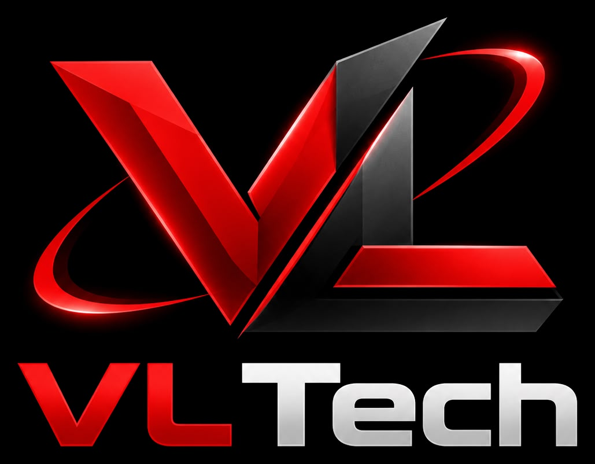

# ⚡ VL Tech — High Performance Software Engineering

<div align="center">



**Experiência Web 3D Cinemática de Alta Performance**  
*Desenvolvida com foco obsessivo em precisão cirúrgica, animações fluidas em 60/120fps, estética editorial Awwwards e arquitetura modular.*

[](https://vercel.com/new)
[](LICENSE)
[](https://threejs.org/)
[](https://greensock.com/)
[]()

[Documentação Completa](DOCUMENTACAO.md) • [Visão Geral](#-visão-geral) • [Seções & Interações 3D](#-seções--interações-3d) • [Padrão de Criação](#-padrão-de-criação--aprendizados-técnicos) • [Como Executar](#-como-executar-localmente)

</div>

---

## 📖 Visão Geral

A **VL Tech** é um estúdio de engenharia de software de alta performance especializado em landing pages 3D, sistemas web escaláveis e automações com inteligência artificial.

Esta landing page oficial combina estética editorial minimalista no tema exclusivo **Black, White & Crimson** (`#0A0A0C`, `#111114`, `#F8F8FC` e `#FF1E26`), **Three.js / WebGL**, **CSS 3D Perspective**, **GSAP 3 + ScrollTrigger**, sintetização procedural de som via **Web Audio API** e referências interativas inspiradas na **21st.dev (dev21)** adaptadas 100% para **Vanilla ES Modules** (zero build / deploy instantâneo).

> Para a documentação técnica detalhada (arquitetura completa, inventário de módulos, auditoria de assets e checklist de produção), consulte **[`DOCUMENTACAO.md`](DOCUMENTACAO.md)**.

---

## ✨ Seções & Interações 3D (Ordem do DOM)

1. **💥 Hero — Sticker Swap Headline + Campo WebGL 3D (`#hero`)**  
   Tipografia monumental (`CRIAMOS SOFTWARE / PROJETOS / PRODUTOS / AUTOMAÇÃO`) com sticker animado sobre fundo interativo Three.js (`js/hero-sticker-headline.js`, `js/tech-hero-3d.js`).
2. **🌀 Diferenciais — Túnel de Perspectiva 3D (`#diferenciais`)**  
   8 diferenciais da VL Tech voando em espiral do ângulo áureo com `position: sticky`, GSAP `scrub` e parallax com *idle sleep* (`js/diferenciais-tunnel.js`, `css/sections/diferenciais-tunnel.css`).
3. **💻📱 Perfeição em Qualquer Tela (`#responsividade`)**  
   Notebook 3D que abre no scroll, cascata binária e navegador real com 5 abas (`<iframe>` sob demanda) sincronizado 1:1 com o Carrossel 3D de Celulares dos clientes (`js/responsive-showcase.js`).
4. **🤖 Automação & IA — Portal GPU + Robô 3D Studio PBR (`#automacao`)**  
   Transição 100% GPU mergulhando pela palavra `"AUTOMAÇÃO"` para um palco limpo com o Robô 3D Three.js (`THREE.PMREMGenerator`, olhos de coração 3D `HeartCurve` via `Raycaster`, 4 abas reais — *Instagram 24/7*, *WhatsApp IA*, *CRM & Leads*, *Backoffice IA* — e botão **Testar Ação**) (`js/automacao-portal.js`, `js/automacao-robot-3d.js`).
5. **🧱 Por Que Nos Escolher — Mural Editorial (`#porque-escolher`)**  
   Título de abertura que desaparece ao iniciar o scroll + 8 pilares (6 artes 3D geradas via Nano Banana otimizadas + 2 retratos reais dos sócios) com **texto explicativo solto ao lado fora da caixa do card**, surgindo e sumindo junto com cada imagem (`js/why-choose-wall.js`, `css/sections/why-choose-wall.css`).
6. **🎡 Produtos VL Tech — Roda 3D Auto-Animada (`#produtos`)**  
   Anel 360° (`PRODUTOS VL`) que abre automaticamente no tambor 3D curvo com Play/Pause e exibe 8 produtos reais conectados às seções da página — incluindo abertura direta do modo correspondente no Robô 3D (`js/partners-tech.js`, `css/sections/partners-wheel.css`).
7. **🪪 Co-Founders 3D Access (`#socios-scrolly`)**  
   Crachá 3D com física real de pêndulo e giro 180° entre **Luiz Gabriel** e **Victor Whohlers** (`js/badge-3d.js`, `css/sections/founders-badge.css`).
8. **🕹️ FAQ Editorial & Rodapé Pixel-Pong (`#rodape`)**  
   Acordeão técnico acessível (`#faq`), contatos diretos, animação Pixel-Pong interativa em `<canvas>` (`js/footer-pong.js`) e Voltar ao Topo suave (`js/footer.js`).

---

## 📚 Padrão de Criação & Aprendizados Técnicos

Este repositório mantém uma base viva de conhecimento em [`padrao-criacao/`](padrao-criacao/README.md) e a skill especialista [`.agents/skills/interactive-3d-landing-pages/SKILL.md`](.agents/skills/interactive-3d-landing-pages/SKILL.md):

- **✅ Acertos Validados ([`padrao-criacao/acertos/`](padrao-criacao/acertos/README.md)):**
  - `01` Arquitetura modular, Design Tokens e Web Audio API
  - `02` Motor unificado de scrollytelling horizontal
  - `03` Scrollytelling 3D com CSS `sticky` nativo e adaptação 21st.dev
  - `04` Performance 60/120fps em GSAP, *idle sleep* e GPU compositing limpo
  - `05` Portal GPU unificado, Robô 3D Studio PBR, Mural com texto solto ao lado, Roda 3D de Produtos auto-animada e Dev Server dual-stack
- **⚠️ Erros Documentados ([`padrao-criacao/erros/`](padrao-criacao/erros/README.md)):**
  - `01` Blank voids, sobreposição de texto e pinagem duplicada
  - `02` Monólitos HTML/CSS, `.tsx` solto e assets sem padrão
  - `03` `ScrollTrigger pin` com `<iframe>`, `overflow-x: hidden` e cortes 3D
  - `04` Travamento severo no load/scroll (GSAP + `rAF` + blur GPU + iframes)
  - `05` `SVG clipPath` travando cliques, mola sem `dt`, `wrapRect` obsoleto, título sobreposto e `EADDRINUSE` no preview

---

## 🧩 Arquitetura Modular

```text
VLtech/
├── index.html                           # Página principal (8 seções na ordem exata do DOM)
├── DOCUMENTACAO.md                      # Documentação técnica completa do projeto
├── AGENTS.md                            # Regras obrigatórias de engenharia e Padrão de Criação
├── package.json                         # Scripts dev / start / serve
├── vercel.json                          # Regras de deploy e cache na Vercel
├── scripts/
│   └── dev-server.mjs                   # Servidor local zero-dependência (dual-stack + fallback de porta)
├── css/
│   ├── variables.css / layout.css       # Design tokens VL Tech + base global e navegação
│   └── sections/                        # CSS isolado por seção (8 arquivos)
├── js/
│   ├── main.js                          # Bootstrap na ordem exata do DOM
│   ├── core/                            # GSAP blindado + motor de scroll
│   └── *.js                             # Módulos ES por seção + áudio, cursor, loader, nav, FAQ
├── assets/
│   └── images/                          # Diferenciais, Por Que Nos Escolher (Nano Banana), Portfólio e Sócios
├── padrao-criacao/                      # Base de conhecimento (acertos/ e erros/)
└── .agents/skills/                      # Skill especialista em Landing Pages 3D + 21st.dev
```

---

## 🚀 Como Executar Localmente

```bash
git clone https://github.com/Luiz-Gabriel-m/VL_Tech_Page.git
cd VL_Tech_Page

# Sobe o servidor local dual-stack em http://localhost:3000 (com fallback automático de porta)
npm run dev
```

Também aceita porta customizada: `npm run dev -- --port 5173`.

---

## ☁️ Deploy na Vercel

O projeto é 100% estático (zero build obrigatório) e pronto para deploy contínuo na Vercel:
1. Importe o repositório na [Vercel](https://vercel.com/new) como **Other / Static Site**.
2. O arquivo [`vercel.json`](vercel.json) já configura `cleanUrls` e cabeçalhos de cache otimizados.

---

## 👥 Sócios & Liderança Técnica

<div align="center">

| **Luiz Gabriel** | **Victor Whohlers** |
| :---: | :---: |
| *Co-Founder & Front-end Architect* | *Co-Founder & Cloud Architect* |
| **Expertise:** Front-end, Landing Pages 3D (Three.js/GSAP) & Automações | **Expertise:** Back-end, Arquitetura Cloud, Microsserviços & Segurança |

</div>

---

## 📄 Licença

Este projeto é distribuído sob a licença MIT.

<div align="center">
  <sub>© 2026 VL Tech — Engenharia de Software e Alta Performance. Todos os direitos reservados.</sub>
</div>
